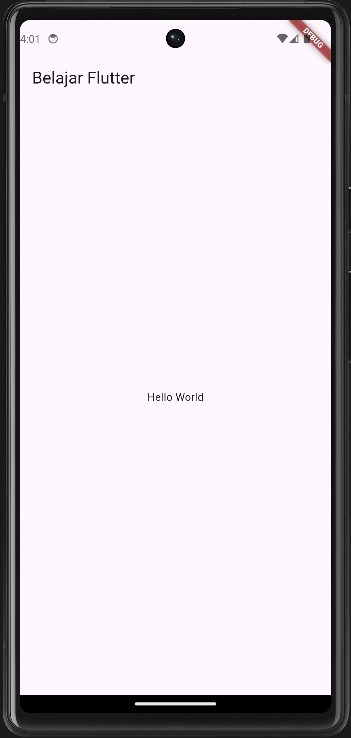
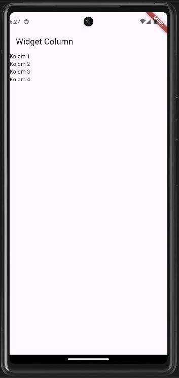
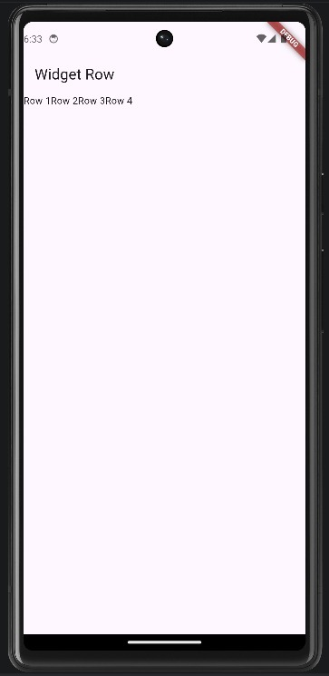
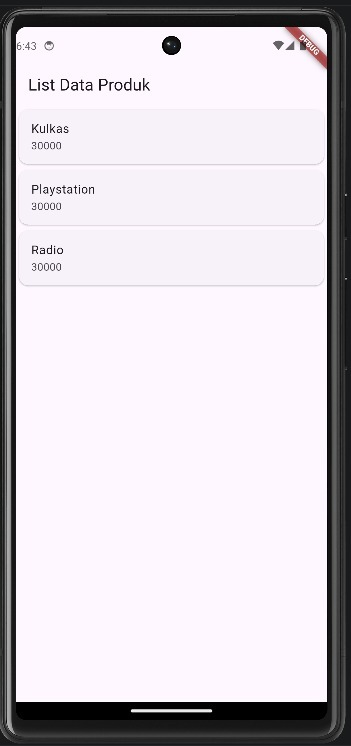

- **Nama:** Jovita Fashya Islami
- **NIM:** H1D024125
- **Shift KRS:** Shift B
- **Shift Praktikum:** Shift I

---

## Modul 2 - Pemrograman Mobile Flutter

Pada praktikum Modul 2 ini, saya mempelajari dasar-dasar pengembangan aplikasi mobile menggunakan Flutter dan bahasa pemrograman Dart. Materi mencakup pemahaman struktur widget dasar (*widget tree*), tata letak menggunakan `Column` (susunan vertikal) dan `Row` (susunan horizontal), pembuatan form input produk menggunakan `TextField` dan `StatefulWidget`, pengiriman data antar halaman dengan `Navigator`, serta menampilkan data produk menggunakan widget `ListView`, `Card`, dan `ListTile`.

---

## Hasil Praktikum

### 1. Hello World

### 2. Widget Column

### 3. Widget Row

### 4. List Data Produk

