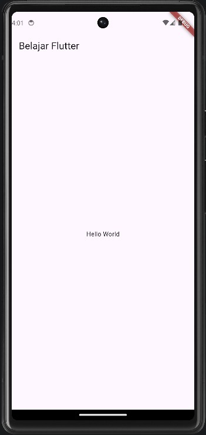
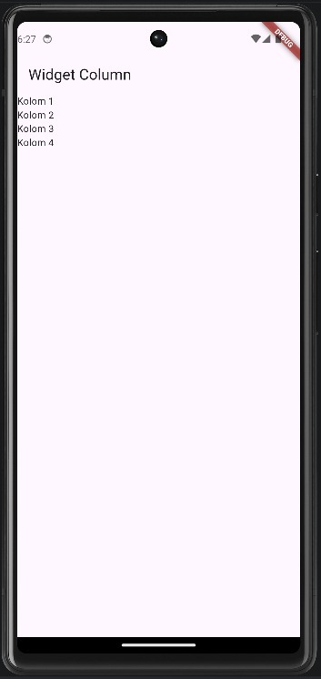
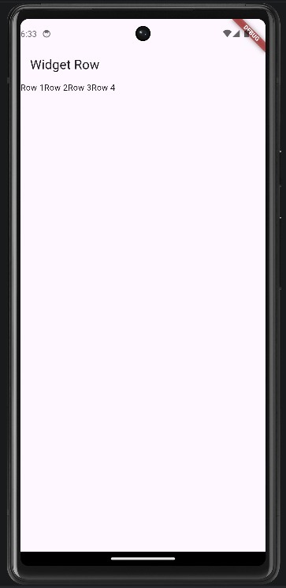
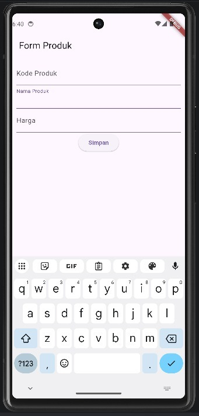
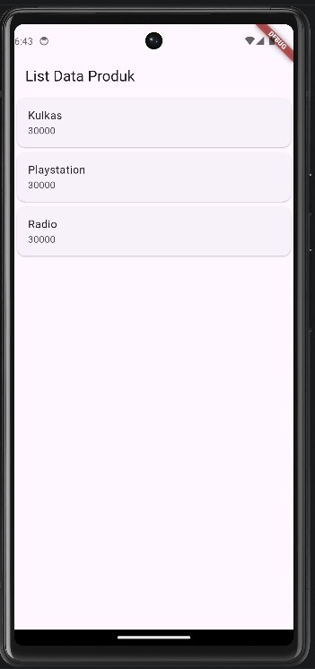

# Identitas Diri
- **Nama:** Jovita Fashya Islami
- **NIM:** H1D024125
- **Shift KRS:** Shift B
- **Shift Praktikum:** Shift I

---

# Modul 2: Pemrograman Mobile (Flutter)

Pada Modul 2 ini, saya mempelajari dasar-dasar pengembangan aplikasi mobile menggunakan framework **Flutter** dan bahasa pemrograman **Dart**. Materi yang dipelajari mencakup konsep dasar widget, penyusunan tata letak (*layouting*), pembuatan formulir input, pengelolaan *state*, serta penyajian data dalam bentuk daftar (*list*).

---

## Materi yang Dipelajari

### 1. Pengenalan Dasar Flutter & Hello World
- Memahami struktur dasar project Flutter dan konsep *widget tree*.
- Menggunakan widget dasar seperti `MaterialApp`, `Scaffold`, `AppBar`, `Center`, dan `Text`.
- Mengimplementasikan `StatelessWidget` untuk menampilkan tampilan statis sederhana (*Hello World*).

### 2. Dasar Layouting: Column & Row
- **Column Widget:** Mengatur posisi elemen/widget secara vertikal dari atas ke bawah menggunakan widget `Column` dan properti `children`.
- **Row Widget:** Mengatur posisi elemen/widget secara horizontal dari kiri ke kanan menggunakan widget `Row` dan properti `children`.

### 3. Form Input Data & Stateful Widget
- Menerapkan `StatefulWidget` untuk komponen yang memiliki perubahan data dinamis (*state*).
- Menggunakan `TextEditingController` untuk mengontrol, membaca, dan mengelola nilai input dari pengguna.
- Membuat komponen input formulir menggunakan `TextField` dengan kustomisasi `InputDecoration` (label text) untuk field:
  - Kode Produk
  - Nama Produk
  - Harga
- Menggunakan `ElevatedButton` sebagai tombol aksi untuk memproses dan mengirim data.
- Menerapkan navigasi dan *passing data* antar halaman menggunakan `Navigator.push` dan `MaterialPageRoute` menuju halaman detail.

### 4. Menampilkan Data (List & Card)
- Menggunakan widget `ListView` untuk membuat daftar item yang dapat di-scroll (*scrollable*).
- Menggunakan kombinasi widget `Card` dan `ListTile` (`title` dan `subtitle`) untuk menyajikan informasi daftar produk secara rapi dan modular.

---

## Hasil Praktikum (Screenshots)

### 1. Hello World
Tampilan awal aplikasi Flutter dengan struktur dasar `Scaffold` dan widget `Center`.

---

### 2. Layout Widget Column
Penyusunan teks secara vertikal menggunakan widget `Column`.

---

### 3. Layout Widget Row
Penyusunan teks secara horizontal menggunakan widget `Row`.

---

### 4. Form Produk
Halaman formulir input data produk menggunakan `TextField` dan `ElevatedButton`.

---

### 5. List Data Produk
Tampilan daftar data produk menggunakan kombinasi widget `ListView`, `Card`, dan `ListTile`.

