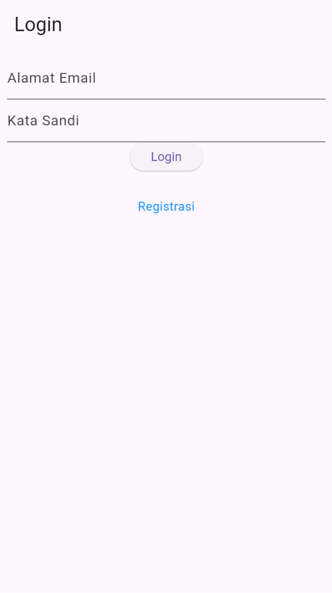
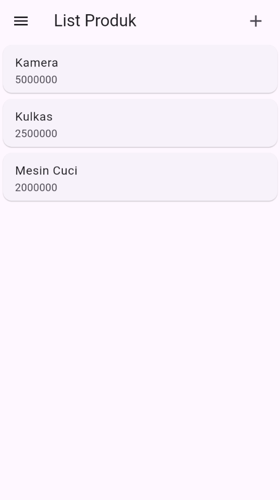
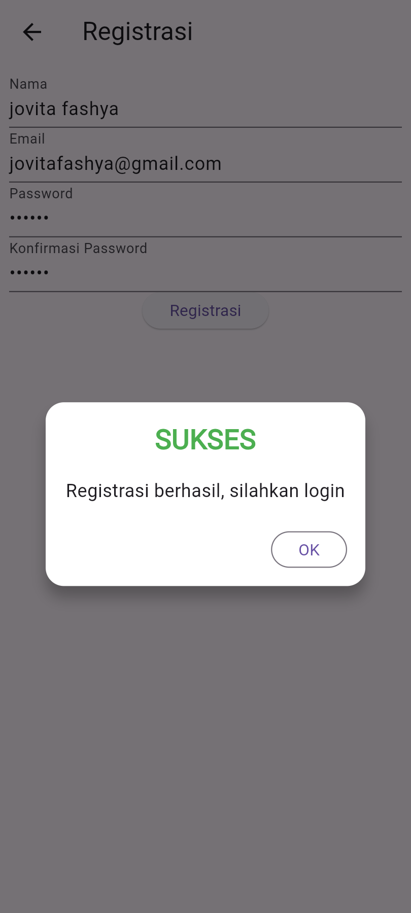
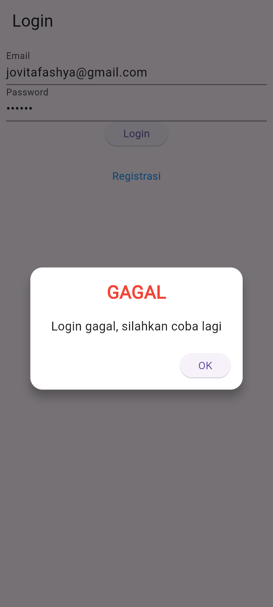

* Nama: Jovita Fashya Islami
* NIM: H1D024125
* Shift KRS: Shift B
* Shift Praktikum: Shift I

# Modul 4 - Praktikum Pemrograman Mobile

Pada praktikum Modul 4 ini, saya mempelajari dan mempraktikkan perancangan antarmuka pengguna (User Interface/UI) secara komprehensif serta penerapan struktur data berbasis model (Model-View) pada aplikasi Flutter bernama **Toko Kita**. 

Fokus utama pembelajaran pada modul ini meliputi:
1. **Pembuatan dan Penggunaan Model Data:** Mempelajari bagaimana memodelkan entitas data dunia nyata ke dalam class Dart (`Login`, `Registrasi`, `Produk`) lengkap dengan atribut, constructor, serta mapping data agar alur data antar halaman lebih terstruktur, aman, dan mudah dikelola.
2. **Form Handling & Validasi Input:** Mempelajari pembuatan formulir interaktif menggunakan widget `Form`, `TextFormField`, dan `GlobalKey<FormState>`. Mengimplementasikan kontrol input menggunakan `TextEditingController` serta validasi data (misalnya memastikan field tidak boleh kosong, validasi format email, pengecekan panjang karakter password, dan kesesuaian konfirmasi password).
3. **Manajemen Navigasi dan Alur Halaman:** Menerapkan routing dan perpindahan halaman menggunakan `Navigator.push` dan `MaterialPageRoute`, baik untuk navigasi antar form (Login ke Registrasi) maupun passing object data antar halaman (dari List Produk ke Halaman Detail dan Halaman Ubah Produk).
4. **Desain Komponen UI & Layout Flutter:** Menggunakan beragam widget layout seperti `Scaffold`, `AppBar`, `ListView`, `Card`, `Drawer` untuk menu samping/logout, serta dialog konfirmasi aksi menggunakan `AlertDialog`.

---

## Hasil Praktikum

### 1. Halaman Registrasi
Halaman registrasi digunakan untuk pendaftaran akun pengguna baru. Halaman ini memuat formulir input data yang terdiri dari Nama, Email, Password, dan Konfirmasi Password dengan validasi input, serta tombol Registrasi untuk memproses pembuatan akun.

### 2. Halaman Login
Halaman login berfungsi sebagai gerbang autentikasi pengguna ke dalam sistem aplikasi. Terdapat form input Alamat Email dan Kata Sandi, tombol Login untuk masuk, serta tombol/link navigasi menuju halaman Registrasi jika pengguna belum memiliki akun.

### 3. Halaman List Produk
Halaman utama setelah autentikasi yang menampilkan daftar katalog produk. Data produk disajikan menggunakan widget `ListView` dan komponen `Card` (menampilkan nama produk dan harga). Halaman ini juga dilengkapi dengan `Drawer` menu (opsi logout) pada sisi kiri AppBar serta tombol tambah produk (`+`) pada bagian kanan AppBar.

### 4. Halaman Tambah Produk
Halaman formulir yang dibuka saat pengguna menekan tombol `+` pada halaman List Produk. Form ini menyediakan input Kode Produk, Nama Produk, dan Harga Produk, serta tombol Simpan untuk menambahkan data produk baru ke dalam sistem.

### 5. Halaman Detail Produk
Halaman yang menampilkan rincian informasi lengkap dari produk yang dipilih pada daftar produk (menampilkan Kode Produk, Nama Produk, dan Harga). Dilengkapi dengan dua tombol aksi utama: tombol **EDIT** untuk mengubah data produk dan tombol **DELETE** untuk menghapus data produk yang dilengkapi dialog konfirmasi.

### 6. Halaman Ubah Produk
Halaman formulir edit yang terbuka ketika tombol EDIT pada halaman detail produk ditekan. Input field pada halaman ini secara otomatis terisi dengan data produk yang sudah ada sebelumnya (*pre-filled*), sehingga pengguna dapat memperbarui informasi produk dan menekan tombol Ubah untuk menyimpan perubahannya.

---

# Modul 4 (Lanjutan) - Pertemuan Terakhir: CRUD dengan REST API

Pada pertemuan terakhir Modul 4 ini, aplikasi **Toko Kita** dikembangkan dari yang sebelumnya hanya berupa tampilan (UI) dengan data statis menjadi aplikasi yang terhubung langsung ke **REST API**. Seluruh proses registrasi, login, dan pengelolaan data produk (Create, Read, Update, Delete) kini dijalankan melalui request ke server.

## Yang Dipelajari

1. **Menambahkan Dependency:** Menggunakan package `http` untuk mengirim dan menerima request ke REST API, serta `shared_preferences` untuk menyimpan token secara lokal di perangkat.
2. **Helper Module:**
   - `user_info.dart`: menyimpan, mengambil, dan menghapus token serta user ID (dipakai untuk login dan logout).
   - `app_exception.dart`: kumpulan class exception untuk menangani berbagai jenis error saat berkomunikasi dengan API.
   - `api.dart`: fungsi `POST`, `GET`, dan `DELETE` yang otomatis menyertakan token (`Bearer`) pada header, serta memetakan status code respons ke exception yang sesuai.
   - `api_url.dart`: menyimpan seluruh endpoint API di satu tempat agar mudah dikelola.
3. **Bloc (Controller):** Memisahkan logika bisnis dari tampilan melalui `RegistrasiBloc`, `LoginBloc`, `LogoutBloc`, dan `ProdukBloc`, sehingga UI cukup memanggil fungsi tanpa mengurus detail request.
4. **Common Dialog Widget:** Membuat `SuccessDialog` dan `WarningDialog` sebagai komponen yang dapat dipakai ulang untuk menampilkan hasil proses (berhasil atau gagal).
5. **Session Login:** Memodifikasi `main.dart` agar aplikasi mengecek token saat dibuka. Jika token ada, langsung masuk ke halaman List Produk. Jika tidak, masuk ke halaman Login.
6. **Menampilkan Data dari API:** Menggunakan `FutureBuilder` untuk mengambil daftar produk dari server dan menampilkannya dengan `ListView.builder`, lengkap dengan indikator loading.
7. **Operasi CRUD:**
   - **Create:** menambah produk baru lewat form dan `ProdukBloc.addProduk`.
   - **Read:** menampilkan daftar produk dan detail produk.
   - **Update:** mengubah data produk dengan form yang terisi otomatis (pre-filled) melalui `ProdukBloc.updateProduk`.
   - **Delete:** menghapus produk setelah konfirmasi lewat `ProdukBloc.deleteProduk`.
8. **Penanganan Error & Asynchronous:** Menggunakan `Future`, `async/await`, `.then()`, dan `onError` untuk menangani proses yang berjalan secara asinkron, serta menampilkan dialog gagal saat request bermasalah.
9. **Konfigurasi Android:** Menambahkan izin `INTERNET` dan `usesCleartextTraffic` pada `AndroidManifest.xml` agar aplikasi dapat mengakses API berbasis `http://`.

## Hasil Praktikum

### 1. Registrasi Berhasil
Data registrasi dikirim ke REST API melalui `RegistrasiBloc`. Jika berhasil, muncul dialog **SUKSES** dengan pesan "Registrasi berhasil, silahkan login".

### 2. Login Gagal
Jika email atau password tidak sesuai, atau server tidak dapat dihubungi, aplikasi menangkap error melalui `onError` dan menampilkan dialog **GAGAL** dengan pesan "Login gagal, silahkan coba lagi".

