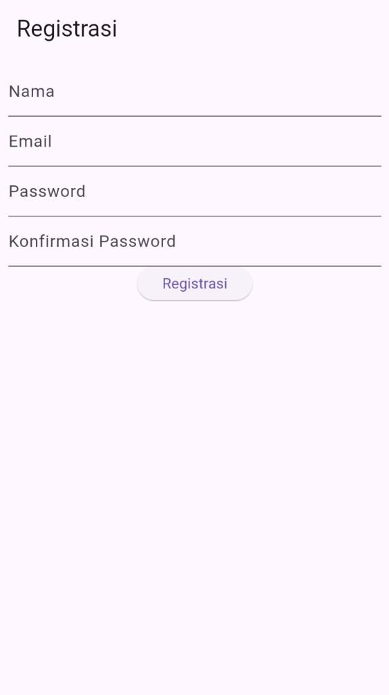
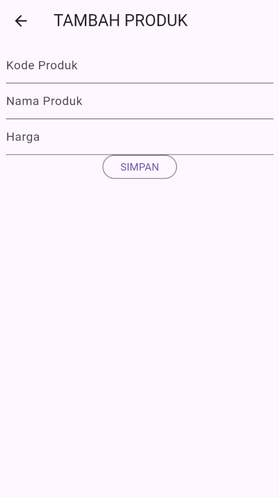
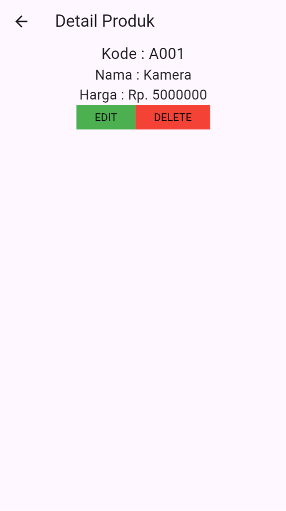
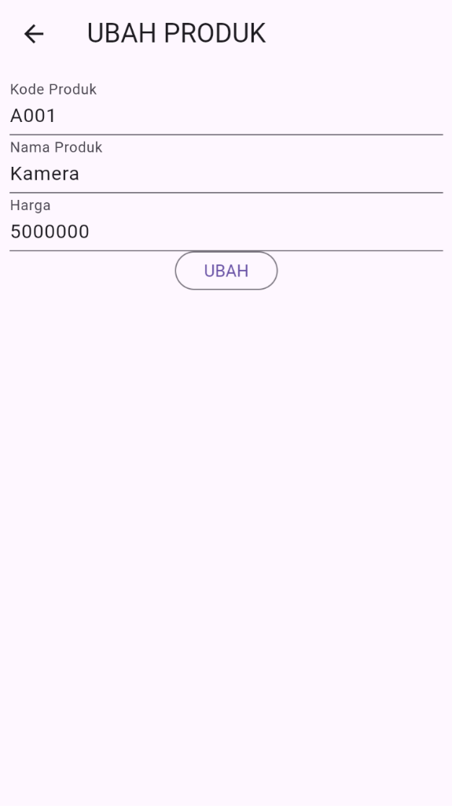

* Nama: Jovita Fashya Islami
* NIM: H1D024125
* Shift KRS: Shift B
* Shift Praktikum: Shift I

# Modul 4 - Praktikum Pemrograman Mobile

Pada praktikum Modul 4 ini, saya mempelajari dan mempraktikkan perancangan antarmuka pengguna (User Interface/UI) secara komprehensif serta penerapan struktur data berbasis model (Model-View) pada aplikasi Flutter bernama **Toko Kita**. 

Fokus utama pembelajaran pada modul ini meliputi:
1. **Pembuatan dan Penggunaan Model Data:** Mempelajari bagaimana memodelkan entitas data dunia nyata ke dalam class Dart (`Login`, `Registrasi`, `Produk`) lengkap dengan atribut, constructor, serta mapping data agar alur data antar halaman lebih terstruktur, aman, dan mudah dikelola.
2. **Form Handling & Validasi Input:** Mempelajari pembuatan formulir interaktif menggunakan widget `Form`, `TextFormField`, dan `GlobalKey<FormState>`. Mengimplementasikan kontrol input menggunakan `TextEditingController` serta validasi data (misalnya memastikan field tidak boleh kosong, validasi format email, pengecekan panjang karakter password, dan kesesuaian konfirmasi password).
3. **Manajemen Navigasi dan Alur Halaman:** Menerapkan routing dan perpindahan halaman menggunakan `Navigator.push` dan `MaterialPageRoute`, baik untuk navigasi antar form (Login ke Registrasi) maupun passing object data antar halaman (dari List Produk ke Halaman Detail dan Halaman Ubah Produk).
4. **Desain Komponen UI & Layout Flutter:** Menggunakan beragam widget layout seperti `Scaffold`, `AppBar`, `ListView`, `Card`, `Drawer` untuk menu samping/logout, serta dialog konfirmasi aksi menggunakan `AlertDialog`.

---

## Hasil Praktikum

### 1. Halaman Registrasi
Halaman registrasi digunakan untuk pendaftaran akun pengguna baru. Halaman ini memuat formulir input data yang terdiri dari Nama, Email, Password, dan Konfirmasi Password dengan validasi input, serta tombol Registrasi untuk memproses pembuatan akun.

### 2. Halaman Login
Halaman login berfungsi sebagai gerbang autentikasi pengguna ke dalam sistem aplikasi. Terdapat form input Alamat Email dan Kata Sandi, tombol Login untuk masuk, serta tombol/link navigasi menuju halaman Registrasi jika pengguna belum memiliki akun.

### 3. Halaman List Produk
Halaman utama setelah autentikasi yang menampilkan daftar katalog produk. Data produk disajikan menggunakan widget `ListView` dan komponen `Card` (menampilkan nama produk dan harga). Halaman ini juga dilengkapi dengan `Drawer` menu (opsi logout) pada sisi kiri AppBar serta tombol tambah produk (`+`) pada bagian kanan AppBar.

### 4. Halaman Tambah Produk
Halaman formulir yang dibuka saat pengguna menekan tombol `+` pada halaman List Produk. Form ini menyediakan input Kode Produk, Nama Produk, dan Harga Produk, serta tombol Simpan untuk menambahkan data produk baru ke dalam sistem.

### 5. Halaman Detail Produk
Halaman yang menampilkan rincian informasi lengkap dari produk yang dipilih pada daftar produk (menampilkan Kode Produk, Nama Produk, dan Harga). Dilengkapi dengan dua tombol aksi utama: tombol **EDIT** untuk mengubah data produk dan tombol **DELETE** untuk menghapus data produk yang dilengkapi dialog konfirmasi.

### 6. Halaman Ubah Produk
Halaman formulir edit yang terbuka ketika tombol EDIT pada halaman detail produk ditekan. Input field pada halaman ini secara otomatis terisi dengan data produk yang sudah ada sebelumnya (*pre-filled*), sehingga pengguna dapat memperbarui informasi produk dan menekan tombol Ubah untuk menyimpan perubahannya.

