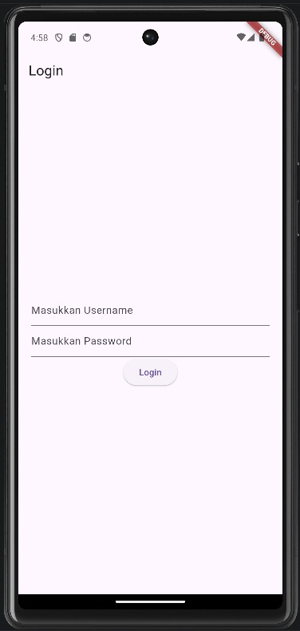
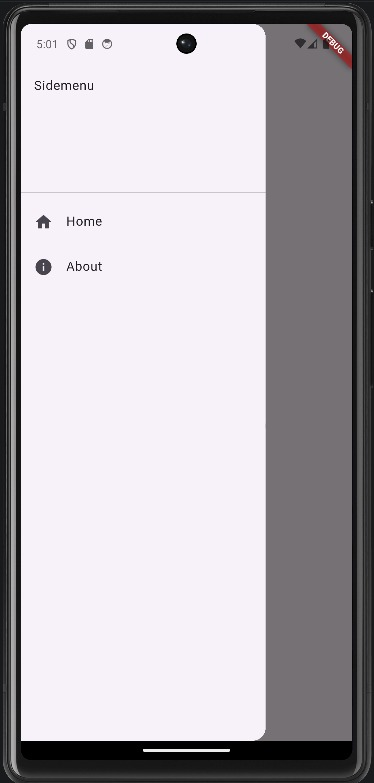
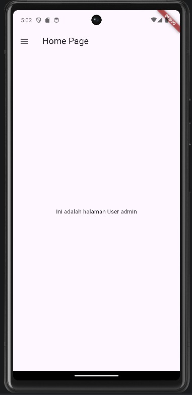

* Nama: Jovita Fashya Islami
* NIM: H1D024125
* Shift KRS: Shift B
* Shift Praktikum: Shift I

# Modul 3 - Pemrograman Mobile Flutter

Pada praktikum Modul 3 ini, saya mempelajari cara membuat aplikasi Flutter yang memiliki sistem login, navigasi antar halaman, dan penyimpanan data lokal. Materi mencakup pembuatan halaman login menggunakan `TextField` dan `TextEditingController`, penyimpanan username ke local storage dengan package `shared_preferences`, penampilan kembali data yang tersimpan pada halaman Home, pembuatan side menu menggunakan `Drawer` dan `ListTile`, serta perpindahan antar halaman dengan `Navigator.push` dan `MaterialPageRoute`.

## Hasil Praktikum

### 1. Halaman Login

Halaman login berisi input username dan password. Jika username dan password yang dimasukkan adalah `admin`, akan muncul dialog berhasil login lalu aplikasi berpindah ke halaman Home. Username yang digunakan juga disimpan ke local storage.

### 2. Side Menu

Side menu dibuat menggunakan widget `Drawer` yang berisi menu Home dan About untuk berpindah antar halaman.

### 3. Halaman Home

Halaman Home menampilkan username yang sudah disimpan pada local storage saat login, sehingga tampilan sesuai dengan user yang masuk.

